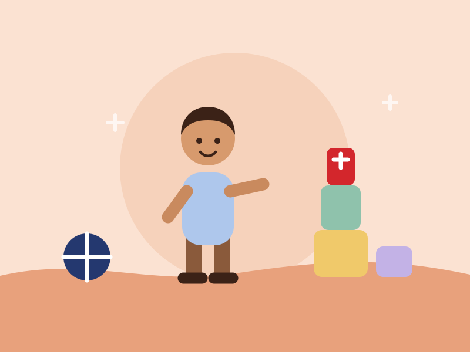

# J & S Tots Pre-School — Munyonyo

A five-page marketing site for J & S Tots Pre-School, Munyonyo, Kampala.

Plain HTML, CSS and JavaScript. No build step, no framework, no dependencies —
copy the folder onto any host (Hostinger, Netlify, cPanel, GitHub Pages) and it works.

## Run it locally

```bash
node server.js
```

Then open <http://localhost:4188>. Pass a port as an argument to use a different one.

## Pages

| File | What's on it |
| --- | --- |
| `index.html` | Hero, why-choose-us, mission, class carousel, day flow, values, enrol CTA |
| `about.html` | Mission, vision, focus, the approach, the five values |
| `programmes.html` | Playing Class, Nursery, Primary One, Kids Activity, typical day |
| `admissions.html` | How to enrol, what to bring, enquiry form, FAQ |
| `contact.html` | Phone, WhatsApp, location, hours, enquiry form, directions |
| `404.html` | Served by `server.js` for unknown paths |

## Where the content came from

Everything factual on the site comes from the school's own two posters:

- **The flyer** — name, Munyonyo, Playing / Nursery–P.1 / Kids Activity, admissions
  open, "colourful classrooms, experienced staff, activity-based learning",
  8:00 am – 5:00 pm Mon–Fri, 0774 197 708, opposite Munyonyo C.O.U. Church.
- **The mission board** — the mission, vision, focus and the five values, quoted
  almost word for word (spelling tidied, meaning unchanged).

Anything the posters did not state is either framed as an outline (the daily
timetable) or sent to a phone call (fees, uniform, term dates, exact class ages).
**There are no invented facts, no fake parent testimonials and no made-up figures.**
The "What we stand for" carousel on the home page quotes the school's real values
rather than inventing reviews — swap it for genuine parent quotes once you have them.

## Things to update before going live

1. **Map link** — `contact.html` currently searches Google Maps for *Munyonyo C.O.U.
   Church* as a landmark. Replace that `href` with the school's own map pin.
2. **Fees and term dates** — deliberately not published. If you want them on the
   site, add them to the FAQ in `admissions.html`.
3. **Email address** — there isn't one on the posters, so the site uses phone and
   WhatsApp only. If the school has an email, add it to the footer and contact page.
4. **Social links** — the footer has WhatsApp and phone. Add Facebook/Instagram if
   the school has accounts.

## Swapping the illustrations for photos

The pictures are hand-drawn SVGs in `assets/img/` so the site looks finished without
using stock photos of other people's children. Replacing them with real photos is a
one-line change each — the CSS already crops and rounds whatever you drop in:

```html
<!-- before -->

<!-- after -->

```

Suggested sizes: hero `1600×1000`, card and split images `1200×900`. Write a real
`alt` description for each, and get parents' permission before putting children's
photographs online.

## Design system

Taken from the reference site in the brief, re-pitched around the school's own badge
colours (red, navy, green from the logo; the flyer's amber).

| Token | Value | Used for |
| --- | --- | --- |
| `--cream` | `#faf3e6` | Page background |
| `--sand` | `#f7e3bc` | Footer, CTA panel |
| `--ink` | `#3b2217` | Text, dark bands, primary buttons |
| `--red` | `#d3262c` | Brand accent, numbers, primary CTA |
| `--navy` | `#24386f` | Brand accent |
| `--green` / `--gold` | `#2e8b57` / `#f2a71b` | Brand accents |
| `--lav` `--sage` `--peach` `--sky` `--butter` | pastels | Icon tints, tilt cards |

Type is **Quicksand** for headings and **Nunito** for body, both from Google Fonts.
All tokens live at the top of `assets/css/style.css`.

## Behaviour

`assets/js/main.js` is dependency-free and everything degrades without it:

- Mobile menu (click, Escape, click-outside to close)
- Scroll reveals via `IntersectionObserver`, skipped under `prefers-reduced-motion`
- Carousels scroll to real snap positions, with arrows that disable at each end
- Rotating news ticker in the hero
- FAQ accordion
- Enquiry form composes a WhatsApp message and opens it — **nothing is sent until
  the parent presses send inside WhatsApp.** There is no server and no database, so
  no personal data is stored anywhere.

## Motion

### The hero and the sheet

On the home page the hero **pins** and the rest of the page rides up over it. That
overlap is plain `position: sticky` plus stacking order, not an animation, so it
works in every browser.

It needs one piece of markup: everything below the hero lives in a single
`<div class="after-hero">` wrapper. It cannot be done per-section — the sections are
transparent, so a pinned hero would show straight through them. **If you add a
section to `index.html`, put it inside that wrapper.**

As the sheet climbs, the hero recedes behind it: the wording lifts and fades, the
card dims and settles back, and the picture pushes in slowly. Three layers at three
speeds, which is what makes it read as depth rather than as a fade.

The timeline for that comes from `.after-hero`, not from the hero itself. A pinned
element never moves, so its own view timeline sits at progress 0 for the whole page;
measuring the sheet climbing over it gives the motion something that actually
travels, and it finishes exactly as the hero disappears. That needs
`timeline-scope: --cover` on `main`, because the hero is a *preceding* sibling of the
element declaring the timeline.

**The hero must stay nearly as tall as the viewport, and that is load-bearing rather
than styling.** The fade is driven by the sheet *entering* the viewport, so a short
hero means the sheet is already on screen at scroll 0 and the hero renders part-faded
before anyone has touched the page. Below roughly 85% of the viewport height it
shows. An earlier `min-height: clamp(470px, 76vh, 720px)` put a 1920x1200 screen at
74% and rendered the headline at 0.81 opacity on load; a 375x812 phone sat at 67%.
It is now `max(470px, 92lvh)`, which holds the ratio at 0.92 from that phone up to a
1600x1440 monitor. **If you change that min-height, check the headline is still fully
opaque at scroll 0 on a tall screen.**

There is a ceiling as well as a floor, and it exists for the opposite reason. The
hero illustration is 1200x740, and with only a `min-height` the image's own ratio
drove the box on wide, short windows: at 1600x620 the hero came out **888px tall
inside a 620px viewport**, which pushed the bottom-aligned wording clean off the
screen. `max-height: 92lvh` caps it, and `min-height` still wins where the two
disagree, so the 470px floor survives on a very short window.

So the hero has two things to hold at once, and they pull against each other: **at
least ~85% of the viewport height**, or it loads part-faded, and **no more than the
viewport height**, or the wording falls below the fold. Both are satisfied at 0.92.
After changing either value, check a wide short window (1600x620) as well as a tall
one (1920x1200) — each catches only one of the two faults.

The hero itself carries only three things: the programme chips, the headline and the
news ticker. A lede paragraph used to sit between the headline and the ticker, but it
repeated the chips (the programmes) and the ticker (hours, place, phone), so it came
out. The page description meta tag still carries that wording for search engines.

### The hero stage

The hero is a stage. The badge, the news pill and the headline sit in the upper
half, and the cast — four cut-out children — stands along the floor and rises in
front of the bottom of the type. That last part is the move every reference image
makes, so it is worth getting right: at 22vw the graduate's cap reached 66px into
the headline and swallowed the last word, so she is trimmed to land around 40px,
which clips the line without hiding any of it. She sets the overlap for the whole
row because she is the tallest.

The news pill sits **above** the headline rather than below it, which is both the
reference structure (pill, big type, subject) and the only way to keep it clear of
the cast standing in front.

**The row spreads with `space-evenly`, and the overlap had to go.** The children
used to be centred with a negative margin set from the viewport width
(`clamp(-6rem, -4vw, -0.5rem)`). On a short screen the cast floors at its minimum
height, so each child is only ~70px wide — and a -54px margin on a 70px child pulls
them almost on top of each other. The row collapsed to **15% of the card**. The
margin is gone; a width term in `--cast-h` keeps the row inside the card instead, and
`space-evenly` distributes them whatever size they end up. The phone keeps its pair
centred and overlapping, since only two show there.

Every stroke ends in the brand red now, the way the CTA one does, so the cut-outs
read as one family rather than four unrelated colour pairs; the first gradient stop
still differs per child.

**The cast is sized by height, not width**, and that is what makes the overlap
reliable. The headline's bottom edge barely moves across viewports, while the hero
scales with the screen, so width-based sizing made the overlap swing wildly: +139px
on a 1366x768 laptop, +38px at 1440x900, and **-123px at 1920x1080**, where the
effect vanished completely. One `--cast-h` on `.hero-cast` now tracks `92lvh` with a
second term capping it so the row cannot outgrow the card, and the slots take
multiples of it. Measured overlaps are now 43px at 1440x900, around 20px at
1920x1080 and a 24px gap at 1024x768.

The children also stand slightly in front of one another. That negative margin is
not decoration: it is what buys the height on a wide screen without the row
outgrowing the card.

`.hero-cast` is absolutely positioned, deliberately. Four photographs must never be
the thing that decides how tall the hero is — letting a picture drive that height is
the fault that put the wording below the fold twice before.

Below 620px the row changes rather than shrinks. A 340px-wide portrait hero cannot
hold four children tall enough to fill a 92vh card: at four across they shrank to
between 66 and 105px and left a 300px dead zone under the headline. The two most
legible stay, `flex-shrink` is turned off so they keep their size, and the card
edges crop them — which reads as a crowd rather than a squeeze.

### Cutting the photographs out

Two of the four arrived with **no alpha channel** — opaque white rectangles. The rim
traces whatever shape it is given, so they rendered as white boxes with a rectangular
outline. There is no image tooling on this machine (no ImageMagick, no Python, no
sharp), so the backgrounds were removed in a canvas in the browser: a flood fill
seeded from the border pixels, so only white *connected to the edge* is cleared and
interior whites — the jumping boy's shirt stripes — are untouched. A one-pixel alpha
feather trims the fringe.

The same pass downscaled everything to the size it is actually displayed at and
re-encoded to WebP. **The hero payload went from 931KB to 338KB**, and the pupil from
319KB to 105KB. If you replace any of these photographs, check the file has alpha
(`VP8X` with the ALPHA flag) or it will come out as a white box.

The dev server grew a temporary, allowlisted endpoint to receive those files and it
was removed again straight afterwards; `server.js` has no write route.

### The floating stroke

Each cut-out has a **two-colour copy of its own silhouette drifting behind it**,
rather than a fixed ring around it. The photograph is used as the CSS mask, so the
shape follows the child instead of being a disc parked behind them, and scaling it
past 1 is what makes it read as a stroke peeking out at the edges. Each child gets a
different brand pair — red/gold, navy/sky, green/butter, lavender/peach, and gold/red
for the pupil.

**The stroke is held back until its mask image has decoded.** Until then there is
nothing to cut the shape with, so `::before` paints its whole box and you get a
coloured rectangle behind each child — which looks exactly like the cut-out failing.
`main.js` adds `is-ready` once the photographs are decoded (same files, so the mask
is in cache by then), with a 3s backstop. Without scripting the stroke is simply
visible from the start, the same `.js` pattern the scroll reveals use.

It grows about its own **centre**, which matters more than it sounds. Anchored at
`bottom center` a 400px-tall silhouette was pushed about 58px upward at scale 1.1,
and it read as a ghost standing behind the child rather than an outline around them.
From the centre, a far smaller 1.05 gives an even edge the whole way round.

It levitates on `translate`, `rotate` and `scale` only. An earlier version animated
`border-radius` to morph a blob shape, which looks the same but is a paint property:
five shapes morphing would repaint every frame. Rotating and unevenly scaling an
asymmetric silhouette gives the same impression on the compositor.

The stroke needs something to hang on, and an `` is a replaced element that will
not render `::before` — hence `.cast-slot`, which also took over the width from the
images. One `--cast-scale` variable on `.hero-cast` shrinks the whole row on a short
window instead of four separate rules.

With the colour moved to the stroke, the rim on the cut-out itself is down to a white
sticker edge and a lift — five filter passes instead of nine.

**One cost to know about.** Each photograph is now fetched twice: once as the ``
and once as the CSS mask. On the live site the second should come from the HTTP cache
(`max-age=600`); the local dev server sends `no-store`, so it genuinely refetches
there. It is still decoded twice either way, which costs memory on a low-end phone.
If that ever matters, the stroke is the thing to drop.

`pupil.webp` used to straddle the hero seam. The cast now stands along that floor, so
she moved to the CTA panel, which has space beside its centred wording and crops her
cleanly with its own `overflow: hidden`.

**A cascade trap to know about.** The responsive `@media` blocks sit in the middle of
the stylesheet, so any component declared below them wins regardless of the media
query — media queries add no specificity. The CTA's mobile `padding-bottom` was
written in the 900px block and silently did nothing, because `.cta` is declared
further down and its `padding` shorthand overrode it. Overrides for anything declared
below the responsive section go in the **late overrides** block at the foot of the
file.

### Crayon highlights

The marks behind the words that matter are a waxy crayon stroke, not a clean bar.
The texture is an SVG `feTurbulence` filter displacing the shape's edges, so it costs
no bandwidth, stays sharp at any size and roughens the way a crayon skips over paper.
The filter lives at the foot of `index.html`; a page without it simply renders a
clean bar, which is a fine fallback.

Headings use `.hl` (a solid red bar behind white text). Inline accents use `.shout`,
which gets a thinner gold underline instead, so body copy stays readable.

They move twice: each mark draws itself on from the left, the way a crayon is
dragged, then settles into a slow wobble so it never looks printed. The hero's mark
runs on a delay after the headline arrives; the ones further down wait for their
block to be revealed, keyed off the same `.is-in` class the scroll reveals use.

### Two bugs the CTA panel taught me

**`.slot-pupil` lost to `.cast-slot`.** Both are single-class selectors, and
`.cast-slot { position: relative }` is declared further down the file, so the pupil's
`position: absolute` never applied and she rendered in normal flow at the top of the
panel. It is `.cta .slot-pupil` now. Worth remembering: every `.slot-*` rule competes
with `.cast-slot` at equal specificity, so order decides.

**A lazy image has no mask to cut with.** The strokes were revealed by a blind 3s
timeout, but the pupil is `loading="lazy"` and far down the page, so the timer fired
long before her picture existed — and an unmasked stroke paints as a plain coloured
rectangle. Each slot now reveals its own stroke on its own image's `load` event. A
picture that never arrives leaves its stroke hidden, which is the right outcome.

### Playful touches

It is a pre-school, so nothing lands quite flat. `--ease-pop` overshoots a little and
drives the scroll reveals, the class chips spring to size one after another, the
hand-drawn doodles drift on a slow loop, icons shake when you point at them, and
buttons squash when pressed.

The school name sits mid-page as a row of toy bricks (`.blocks`), two of them with
eyes that blink and glance about. The row carries `role="img"` and its own label, so
a screen reader hears "J and S Tots" rather than seven loose letters. Below about
430px the bricks stop fitting on one line, so `.block-gap` becomes a full-width flex
break and the name stacks as J&S over TOTS — left to itself, flex-wrap split it as
"T O / T S".

Two things loop forever: the doodle drift and the name blocks. The blocks are much
the busier — seven bricks and four eyes — so if the page ever needs calming, start
there rather than with the doodles. All of it is transform-only and stays on the
compositor.

### Capitals

The site already set small labels in caps (eyebrows, feature headings, footer
headings). That now extends to the class chips, the primary buttons (`.btn-dark` and
`.btn-red`) and a `.shout` accent for a short key phrase inside body copy.

Headings are deliberately left alone. Caps cost reading speed, which is a fair trade
for a three-word label and a bad one for a sentence like "Where every child is known,
loved and ready to learn." Ghost and link buttons stay sentence case as well, so that
the emphasis on the primary action still means something.

### The two guards

1. Every animation rule sits inside `@media (prefers-reduced-motion: no-preference)`,
   so anyone who has asked their system to reduce motion gets a still page. The
   overlap still works for them, because sticky positioning is not an animation.
2. The scroll-linked rules *also* sit inside `@supports (animation-timeline: view())`,
   and **that guard is load-bearing, not politeness.** A browser that does not know
   `animation-timeline` would drop that one declaration, keep the rest, run the
   keyframes on the document timeline with no duration, and leave the hero parked at
   its end state — a card at opacity 0.2 with invisible headline text. Guarded, those
   browsers get the overlap without the dimming, which still looks deliberate.

Ranges are written against the sheet's own travel (`entry 15% entry 100%`) rather
than in pixels, so the effect keeps its shape on a phone and on a desktop with no
media query of its own.

## Accessibility notes

Skip link, one `h1` per page, `aria-current` on the active nav item, labelled form
fields, `aria-expanded` on the menu and accordion, visible focus rings, and reduced-motion
support throughout. Checked at 375 px and 1280 px with no horizontal scroll.
